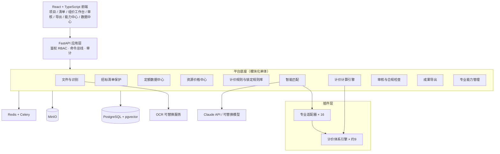

# 01 全专业架构设计

> 状态：待评审。本文是设计方案，不代表任何功能已经实现。

## 1. 设计结论（先读这一节）

1. **16 个专业不等于 16 套计价体系。** 决定计算方式的是"计价体系"（谁发布的定额和费用规则），而不是专业名称。16 个专业落在约 9 个计价体系族上（详见 [03](03-quota-data-plan.md)）。因此架构分两层：**计价体系引擎**（每族一个，承载公式和费用构成）+ **专业适配器**（每专业一个，承载清单分类、特征解析、匹配策略、导出报表）。专业适配器声明自己使用哪个计价体系引擎。
2. **规则是数据，不是代码。** 费率、计算基数、取费程序、舍入方式、不可竞争费用范围全部存为带版本的规则数据，按"地区 + 专业 + 计价标准 + 定额版本 + 招标文件覆盖项"解析。代码里不写死任何费率。
3. **三类数据物理隔离**：原始招标清单（只读）、组价数据（可改）、计算结果（只由引擎写）。隔离由数据库约束保证，不依赖前端或业务代码自觉。
4. **AI 只做选择和解释，不产生数字。** 语言模型只能从数据库中已存在的定额候选里选择并给出理由；所有消耗量、单价、金额由确定性计价引擎用 Decimal 计算。
5. **能力状态由证据计算得出，不能手工标记为"已完成"。** 某专业没有导入合法定额数据时，系统自动显示"数据缺失"，且该专业只开放人工组价。
6. **所有专业从第一版起同权进入架构。** 专业目录、适配器注册、数据库表、项目创建、清单导入保护、人工组价、锁定机制、审计、导出框架对 16 个专业一次建成；差异只体现在数据是否到位。

## 2. 总体架构



模块之间只通过各自的服务接口调用，不跨模块直接读写对方的表。这样保持单体部署的简单，又保证某个专业适配器升级不影响其他专业。

## 3. 专业适配器与计价体系引擎

### 3.1 计价上下文

每个单位工程绑定一个且仅一个**计价依据集**：

```
PricingContext = {
  region            地区（省 / 市）
  profession        专业及子专业
  pricing_standard  计价标准（清单计价规范、费用规则及其版本）
  quota_version     定额体系及版本
  price_date        价格基准期
  tender_overrides  招标文件对费率、税率、暂列金额、取整等的明确规定
}
```

一个项目可以有多个单位工程，每个单位工程有自己的计价上下文，所以一个项目可以同时包含房建、安装、市政等多个专业而互不混用。

### 3.2 专业适配器接口

```python
class ProfessionAdapter(Protocol):
    code: str                      # 如 "municipal"
    pricing_system: str            # 使用的计价体系引擎，如 "sd_construction"
    version: str                   # 适配器自身版本，可独立升级

    def classify_boq_item(self, item) -> BoqClassification: ...
    def parse_features(self, item) -> FeatureSet: ...          # 项目特征结构化
    def retrieve_quota_candidates(self, features, ctx) -> list[QuotaCandidate]: ...
    def check_applicability(self, item, quota, ctx) -> ApplicabilityReport: ...
    def conversion_rules(self, quota, features, ctx) -> list[Conversion]: ...
    def special_checks(self, pricing, ctx) -> list[Finding]: ...  # 专业特有的漏项、重复计价检查
    def export_reports(self, ctx) -> list[ReportSpec]: ...
```

### 3.3 计价体系引擎接口

```python
class PricingSystemEngine(Protocol):
    code: str
    def cost_structure(self, ctx) -> CostStructure: ...   # 费用构成与取费程序
    def compute_item(self, composition, prices, ctx) -> ItemResult: ...  # 综合单价
    def compute_measures(self, unit_project, ctx) -> MeasureResult: ...
    def compute_summary(self, unit_project, ctx) -> SummaryResult: ...   # 规费、税金、汇总
    def locked_fee_items(self, ctx) -> list[LockedFee]: ...
```

适配器和引擎通过 Python entry points 注册，注册信息同步写入 `profession_adapters` 表。未注册引擎的专业无法执行自动计算，能力中心会如实显示。

## 4. 招标清单保护机制

| 层 | 措施 |
| --- | --- |
| 存储 | `tender_boq_versions`、`tender_boq_items` 两表只允许 INSERT。数据库触发器拒绝 UPDATE 和 DELETE；应用数据库账号不授予这两项权限 |
| 指纹 | 每条清单按（编码、名称、特征、单位、工程量、层级位置）计算 SHA-256；每个版本计算整体哈希。任何时点都能证明数据未被改动 |
| 分离 | 组价数据 `pricing_compositions` 只通过 `boq_item_id` 引用清单，不复制清单字段 |
| 识别异常 | 识别置信度低、合价与单价×工程量不符、编码格式异常等只写入 `boq_anomalies`，由人工对照原件确认；不覆盖原始数据。原始文件页码和单元格位置随每条清单保存，方便核对 |
| 补遗和变更 | 导入正式补遗文件生成**新的清单版本**，系统给出与旧版本的逐项差异，人工确认后生效。旧版本保留。已有组价按清单编码和指纹迁移，变更项标记为待复核 |
| 导出 | 导出前强制执行一致性检查：导出文件中的清单字段与有效清单版本逐项、逐字段比对，不一致则禁止导出 |

说明：识别环节本身可能出错（扫描件、合并单元格）。如果确认是识别错误而非招标人原文如此，处理方式是**重新识别并生成新的识别版本**，保留旧版本和操作人记录，而不是就地修改。

## 5. 不可竞争费用锁定

### 5.1 规则库

`non_competitive_fee_rules` 按（地区、专业、计价标准、生效日期）存储：费用项、计算公式、计算基数的定义、费率、依据文件及条款。招标文件另有规定时，以 `tender_overrides` 记录并附原文页码。不同地区和专业各自成行，不共用。

### 5.2 锁定对象

锁定的是**费率、计算基数的定义和公式**，以及招标人给定的固定金额（如暂列金额、暂估价）。

需要说明一个容易误解的点：有些不可竞争费用的计算基数本身包含可竞争内容，报价变化时金额会按公式合法地随之变化。系统禁止的是绕开公式的修改，具体包括：

- 直接改锁定费用的金额或费率；
- 改变基数的构成（从基数中剔除或加入费用项）；
- 批量调价、报价优化、竞争性下浮的作用范围包含锁定项。

锁定类型由规则数据声明，目前有四种：固定费率（工伤保险、增值税）、费率下限（山东省 2025 版规则的安全文明措施费，“费率不低于”规定值，可以高报不能低报）、招标文件给定金额（暂列金额、专业工程暂估价）、招标文件给定等级（优质优价费的创建目标）。招标文件另有规定的，以招标文件为准并记录出处。

### 5.3 实现

- 锁定费用的金额没有写入接口，只能由计价引擎计算产生；
- 后端在命令层校验：任何命令的作用目标若命中锁定项，直接拒绝并记录审计；
- 数据库层：`calc_results` 中锁定行带 `locked=true`，由触发器保证只有引擎角色可写；
- 前端只读展示，并显示计算依据（规则条款、基数明细、费率）；
- 每次计算保存锁定费用的完整计算轨迹。

## 6. 计价计算引擎

- 独立 Python 包，不依赖 Web 框架和数据库，输入输出为纯数据结构，便于单独测试和复算；
- 全程 `Decimal`；舍入方式、各级精度、先汇总后舍入还是先舍入后汇总，均来自规则数据；
- 取费程序用**声明式规则表**描述（费用项、基数表达式、费率引用、舍入策略）。基数表达式是受限语法，只能引用已定义的费用项，不执行任意代码；
- 计算链：定额消耗量 × 工程量 → 资源汇总 → 资源价格 → 人材机费 → 管理费、利润、风险 → 综合单价 → 清单合价 → 措施项目、其他项目 → 规费、税金 → 单位工程、单项工程、项目汇总；
- 每次计算生成**计算快照**：输入数据哈希、规则版本、适配器版本、引擎版本、全部中间结果。相同输入必须得到相同结果；
- 每个金额可以下钻到公式、基数和来源数据；
- 语言模型不参与任何数值计算。

## 7. 智能定额匹配

流程：

1. **特征解析**：语言模型把项目特征文本抽取成结构化字段（材质、规格、部位、工艺、厚度等），字段模式由专业适配器定义；
2. **候选检索**：先按计价上下文硬过滤（地区、专业、定额版本），再做关键词检索和 pgvector 语义检索；
3. **适用性判断**：语言模型在候选集内比较工作内容、适用条件、计量单位，输出选择、理由和差异分析。**输出的定额编号必须存在于候选集，否则整条结果作废**；
4. **规则校验**：单位换算是否成立、工作内容是否覆盖清单特征（漏套）、多条定额工作内容是否重叠（重复计价）、是否需要换算；
5. **置信度与分流**：高置信度进入"已匹配待复核"，低置信度或无候选进入人工审核队列，并说明原因。

支持一对一、一对多、多对一、组合、换算、补充定额（补充定额必须人工录入并标注依据，系统标记为"补充"，不混入正式定额库）、人工指定和更换。每条结果展示定额依据、版本、适用条件、匹配理由和差异。

没有导入该专业定额数据时，步骤 2 返回空，系统提示数据缺口，**不会回退到其他专业的定额**。

人工对匹配结果的修改会沉淀为企业匹配经验（清单特征 → 定额），作为后续检索的参考，但不自动等同于正确答案。

## 8. 人工操作、权限与审计

- 角色：系统管理员、数据管理员（定额、价格、规则）、造价编制人、审核人、只读查看。权限细到项目和单位工程；
- 所有修改以**命令**形式提交（改定额、增删子目、换算、改消耗量、改价格、替换资源、调费率、批量修改、复制方案），每条命令记录操作人、时间、前后值、原因；
- 撤销和恢复基于命令日志实现；
- 报价版本：任何时点可以存为版本，支持两个版本逐项对比；
- 规则数据决定哪些字段可改。消耗量是否允许调整、哪些费率可竞争，由计价依据和招标文件决定，界面按此开放或置灰。

## 9. 文件识别

- PDF 用 PyMuPDF 取文字和表格，扫描件走 OCR 服务；Excel 用 openpyxl；Word 用 python-docx；
- 识别内容保留页码、表格位置，建立索引；
- 语言模型抽取：项目所在地、行业和专业、单位工程划分、计价要求（计价依据、费率规定、税率、暂列金额、最高投标限价、报价格式要求），每项附原文出处，人工确认后才写入计价上下文；
- 专业判定给出依据和置信度，由人工确认，不自动生效；
- 清单优先从招标人提供的 Excel 或电子清单文件读取，PDF 表格识别作为备选。

## 10. 成果导出

- **优先填写招标人原始模板**：保留原表结构，只写入允许填写的单元格；
- 无模板时使用专业适配器提供的标准报表集（`profession_export_templates`）；
- Excel、PDF 为内置格式。招标平台电子数据交换格式为每种格式一个导出插件，需要取得对应平台的公开接口规范后开发；
- 导出前执行：清单一致性检查、锁定费用检查、算术闭合检查、未完成项检查。

## 11. 数据库设计

### 11.1 全专业管理实体（任务书第十五章）

| 表 | 主要字段 | 说明 |
| --- | --- | --- |
| engineering_professions | code, name, parent_id, sort | 专业分类树，可增改 |
| profession_subcategories | profession_id, code, name | 子专业 |
| profession_adapters | profession_id, adapter_code, pricing_system, version, status | 适配器注册 |
| profession_capabilities | profession_id, region_id, capability, status, evidence, computed_at | 能力状态，由系统计算 |
| region_catalog | code, name, level, parent_id | 国家、省、市 |
| pricing_standard_catalog | code, name, issuer, doc_no, effective_from, effective_to, region_id | 计价标准 |
| quota_version_catalog | code, name, issuer, version, effective_from, region_id, source, license_info, import_status | 定额版本及授权信息 |
| profession_quota_mapping | profession_id, quota_version_id, region_id, scope_note | 专业可用的定额版本 |
| profession_fee_rule_mapping | profession_id, fee_rule_set_id, region_id | 专业使用的费用规则集 |
| profession_resource_mapping | profession_id, resource_category_id | 专业特有资源分类 |
| profession_export_templates | profession_id, region_id, report_code, template_file | 导出模板 |
| profession_test_cases | profession_id, project_ref, baseline_ref, status, metrics | 真实项目测试样本 |
| profession_coverage_reports | profession_id, region_id, generated_at, content | 覆盖报告 |

### 11.2 业务实体

- 项目：projects, unit_projects（含计价上下文）, project_members
- 文件：files, file_pages, file_extractions
- 原始清单（只读）：tender_boq_versions, tender_boq_items, boq_anomalies, tender_requirements
- 定额：quota_chapters, quota_items, quota_item_resources, quota_notes, quota_conversions, quota_embeddings, supplementary_quotas
- 资源和价格：resources, resource_categories, resource_prices（地区、日期、规格、单位、含税状态、来源、有效期）, price_sources
- 规则：fee_rule_sets, fee_rule_items, non_competitive_fee_rules, rounding_policies
- 组价：pricing_schemes, pricing_compositions, composition_quota_lines, composition_resource_overrides, measure_items, other_items
- 计算：calc_runs, calc_results, calc_traces
- 匹配：match_runs, match_candidates, match_decisions, match_experience
- 版本与审计：quote_versions, command_log, audit_log
- 审核：review_findings, review_signoffs

### 11.3 防混用约束

- 所有定额表带 `quota_version_id`；所有规则表带 `fee_rule_set_id`；
- `composition_quota_lines` 用复合外键同时引用 `(quota_item_id, quota_version_id)`，并通过约束保证其 `quota_version_id` 等于所属单位工程计价上下文的版本，数据库层面拒绝跨版本、跨专业引用；
- 资源以（编码、名称、规格、单位）为身份；价格匹配要求规格和单位一致，单位不同时必须有登记的换算关系，否则不匹配并提示。

## 12. 技术栈与工程结构

同一套代码两种部署形态（按贵司 2026-11-14 的答复调整）：

| | 桌面版（Windows exe） | 云端版 |
| --- | --- | --- |
| 数据库 | SQLite 单文件（数据目录在本机） | PostgreSQL + pgvector |
| 文件存储 | 本机文件夹 | MinIO |
| 异步任务 | 进程内任务队列 | Redis + Celery |
| 界面 | 内置浏览器窗口打开本机服务 | 浏览器访问 |
| 打包 | PyInstaller，在 Windows 上构建 | Docker |

后端通过 SQLAlchemy 屏蔽数据库差异，只读触发器对两种数据库分别实现。前端 React + TypeScript；PDF、Excel、Word 解析用 PyMuPDF、openpyxl、python-docx；OCR 和语言模型均为可替换接口（默认 Claude API，桌面版需要联网调用）。

```
guangchuan-pricing/
  backend/
    app/            # FastAPI 应用、鉴权、命令总线
    modules/        # documents, boq, quota, resources, rules, matching, review, export, capability
    engine/         # 独立计价引擎包（无框架依赖）
    pricing_systems/  # 计价体系引擎插件
    professions/      # 16 个专业适配器插件
    migrations/
    tests/
  frontend/
  deploy/
  docs/
```

## 13. 研发阶段与出口条件

| 阶段 | 内容 | 出口条件 |
| --- | --- | --- |
| 1 | 专业分类、数据库、权限、适配器框架 | 16 个专业均已注册，均可创建项目和单位工程 |
| 2 | 文件识别、清单保护 | 只读约束测试通过；补遗版本流程可用 |
| 3 | 清单识别、特征解析 | 各专业样本清单识别结果与原件逐项核对 |
| 4 | 山东省计价依据、定额、资源库框架及导入工具 | 导入校验流程可用；已授权数据完成导入 |
| 5 | 各专业定额匹配 | 无数据专业明确提示缺口；有数据专业达到 [04](04-test-plan.md) 的匹配指标 |
| 6 | 资源价格匹配 | 规格、单位防错测试通过 |
| 7 | 计价引擎及各计价体系引擎 | 与对照报价金额一致 |
| 8 | 人工组价工作台 | 16 个专业均可完成人工组价和计算 |
| 9 | 审核、导出 | 一致性检查、锁定检查、模板导出通过 |
| 10 | 各专业真实项目测试、验收 | 按 [04](04-test-plan.md) 逐专业出具结论 |

## 14. 已确认事项与遗留问题

贵司 2026-11-14 答复：

| 事项 | 答复 | 处理 |
| --- | --- | --- |
| 定额和规则数据 | 从正规网站获取 | 已从官方渠道取得山东省 2025 版费用规则并入库；消耗量定额正文尚未取得，见 [03](03-quota-data-plan.md) |
| 真实项目样本 | 次日提供，先开发 | 先完成平台基础和计价引擎 |
| 资源价格 | 信息价，且须符合招标文件要求 | 价格库以信息价为主来源，招标文件指定价优先 |
| 投标平台 | 山东省公共资源交易中心及各市交易中心为主，也参与央企国企平台 | 导出格式需取得各平台的接口规范后逐个开发 |
| 部署 | 本机 exe，同时部署云端 | 见第 12 节 |

遗留问题：

1. 山东省消耗量定额正文的取得方式（见 [03](03-quota-data-plan.md) 第 2 节）。
2. 招标文件是否允许发送到外部语言模型接口。
3. 用户规模，是否需要多公司隔离。
4. 当前仓库是 IPTV 播放列表仓库，建议为本项目新建独立私有仓库。
